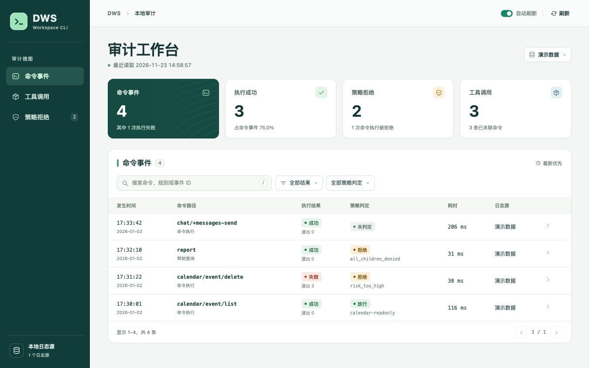

# DWS 本地审计工作台

DingTalk Workspace CLI（DWS）的可选可视化模块。在浏览器里查看命令最终退出码、裁剪策略的判定，以及一次命令调用了哪些底层工具。工作台运行在本机，直接读取 DWS 写出的审计文件。



## 快速开始

需要 macOS 或 Linux、Python 3.9 及以上版本，以及浏览器。服务端只使用 Python 标准库，前端使用随仓库提供的静态文件。

```bash
git clone https://github.com/haofeng0705/dws-audit-viewer.git
cd dws-audit-viewer
python3 server.py --demo
```

打开 [本地工作台](http://127.0.0.1:18765/)。演示模式只读取仓库里的虚构样本。可以在「策略拒绝」里打开 `calendar/event/delete` 查看拒绝原因，或打开 `chat/+messages-send`，追到发送消息和查询投递状态两条工具记录。

## 查看自己的日志

按 Ctrl+C 退出演示，再启动本机日志模式。

```bash
python3 server.py
```

也可以在 macOS 上双击 `打开审计页面.command`。默认依次使用 `DWS_AUDIT_DIR`、`$DWS_CONFIG_DIR/audit` 和 `~/.dws/audit`。如需同时对照两个环境，可复制 `sources.example.json` 为 `sources.json`，修改每个来源的名称和目录，启动时传入该配置。

```bash
# 单个自定义审计目录
python3 server.py --audit-dir /path/to/audit

# 多个来源，或在默认端口已占用时另开服务
python3 server.py --sources sources.json --port 18766
```

| 你的 DWS 写出了什么 | 工作台能看到什么 |
|---|---|
| `audit-YYYYMMDD.jsonl` | 每次工具调用的结果、时间、耗时和执行 ID。使用旧版 DWS 时可直接打开「工具调用」。 |
| `commands/audit-YYYYMMDD.jsonl` 中的 `command.finished` | 命令退出码、错误类别、裁剪判定和命中的规则；通过同一来源内的执行 ID 双向联查命令与工具。 |

命令事件由支持该格式的 DWS 构建产生。裁剪判定和退出码分别展示，例如帮助查询以 `0` 退出，同时策略隐藏了该分组的所有子命令。开启审计、决定策略和生成日志由 DWS 负责。[DWS 命令审计实现（fork PR #6）](https://github.com/haofeng0705/dingtalk-workspace-cli/pull/6)

## 数据读取范围

服务只监听 `127.0.0.1`。前台页面每 5 秒读取一次，可暂停自动刷新或手动刷新。每个来源的命令流和工具流分别最多读取最近 14 个日文件、4 MiB 和 1,000 条事件；达到上限时页面会提示，统计数字对应当前读取窗口。

浏览器只接收展示所需字段。工具参数摘要、操作者身份和原始错误文本留在本地日志文件中。命令与工具详情可以展开查看经过筛选的事件 JSON。日志哈希链的完整性校验可使用 DWS 自带的 `dws audit verify`。

## 开发验证

```bash
python3 -B -m unittest discover -s tests -v
node --check app.js
```

测试在临时目录创建虚构日志，并通过随机本机端口验证实际 HTTP 服务。
